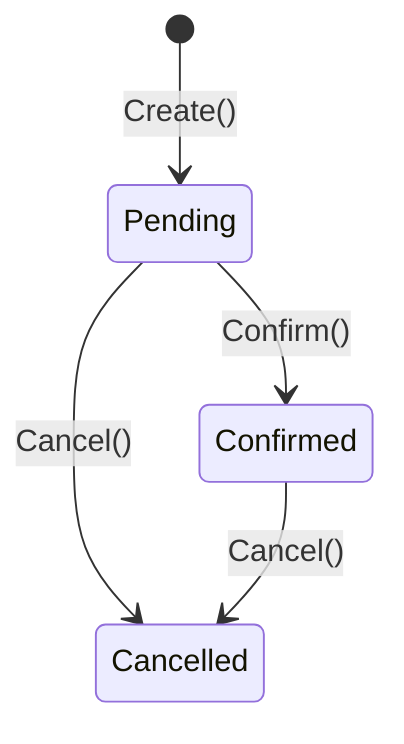
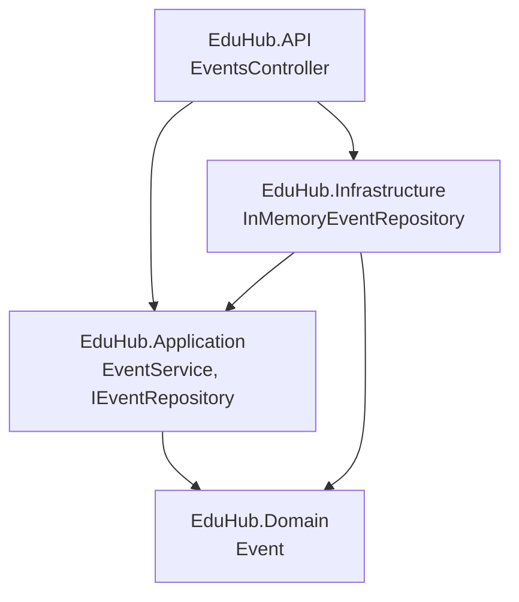

# Trả lời đề giữa kỳ IN4211

## Câu 1a

- **Đóng gói (Encapsulation):** Che giấu trạng thái và chỉ cho phép thay đổi qua các phương thức có kiểm soát. Minh họa: `EduHub.Domain/Entities/Registration.cs`, lớp `Registration` có setter private và các phương thức `Confirm()`/`Cancel()`.
- **Trừu tượng (Abstraction):** Định nghĩa hợp đồng cần dùng mà không buộc bên gọi biết chi tiết cài đặt. Minh họa: `EduHub.Application/Events/IEventRepository.cs`, interface `IEventRepository`.
- **Kế thừa (Inheritance):** Lớp dẫn xuất dùng lại hành vi của lớp cơ sở. Minh họa: `EduHub.Infrastructure/Events/EmailNotificationService.cs`, lớp `EmailNotificationService` kế thừa `ConsoleNotificationService`.
- **Đa hình (Polymorphism):** Cùng một hợp đồng có thể được thực hiện bởi nhiều lớp và chọn cách chạy tương ứng. Minh họa: `EmailNotificationService` và `SmsNotificationService` đều thực hiện `INotificationService` qua lớp cơ sở `ConsoleNotificationService`.

## Câu 1b

Hai vấn đề của lớp `Member` ban đầu:

1. `Id` và `Email` có setter công khai, nên mã bên ngoài có thể thay đổi trạng thái tùy ý sau khi tạo.
2. Constructor công khai cho phép tạo đối tượng chưa hợp lệ; ví dụ `Email = "abc"` không được kiểm tra.

Trong `EduHub.Domain/Entities/Member.cs`, constructor là private, thuộc tính có setter private và `Member.Create(email)` từ chối email rỗng hoặc không chứa `@`.

## Câu 2a

## Câu 2b

`EduHub.Domain/Entities/RegistrationStatus.cs` định nghĩa ba trạng thái `Pending`, `Confirmed`, `Cancelled`. `Registration` có constructor private, factory `Create(memberId, eventId)` kiểm tra hai mã không rỗng, các thuộc tính chỉ có setter private. `Confirm()` chỉ chấp nhận trạng thái `Pending`; `Cancel()` chỉ chấp nhận `Pending` hoặc `Confirmed`. Chuyển trạng thái không hợp lệ ném `InvalidOperationException` trước khi sửa trạng thái.

## Câu 2c

Các kiểm thử nằm trong `EduHub.Tests/RegistrationTests.cs`. Có kiểm thử tạo phiếu ở trạng thái ban đầu, xác nhận phiếu, mã thành viên rỗng và tình huống bắt buộc: sau `Cancel()`, gọi `Confirm()` ném `InvalidOperationException` và trạng thái vẫn là `Cancelled`.

## Câu 3a

- **SRP (Single Responsibility Principle), dòng 6–10:** `EventService` ban đầu vừa xác thực dữ liệu, truy cập cơ sở dữ liệu, ghi log và gửi thông báo. Nhiều trách nhiệm khiến lớp có nhiều lý do để thay đổi.
- **OCP (Open/Closed Principle), dòng 11–14:** Thêm kênh thông báo buộc sửa chuỗi `if/else` trong lớp thay vì mở rộng qua một cài đặt mới.
- **DIP (Dependency Inversion Principle), dòng 8, 12, 14:** Lớp nghiệp vụ phụ thuộc trực tiếp vào `SqlConnection`, `EmailSender` và `SmsSender` thay vì phụ thuộc abstraction.

## Câu 3b

- `Event` ở Domain; `Event.Create(...)` kiểm tra tiêu đề không rỗng và sức chứa lớn hơn 0.
- `IEventRepository`, `INotificationService`, `IEventNotificationFactory` và `EventService` ở Application.
- `InMemoryEventRepository`, `EmailNotificationService`, `SmsNotificationService` và `EventNotificationFactory` ở Infrastructure. Hai kênh thông báo ghi nội dung ra Console. Factory chọn dịch vụ theo `channel`.
- `EventService` nhận repository và dịch vụ thông báo qua constructor, không tạo lớp cụ thể bằng `new`. `Program.cs` đăng ký các dịch vụ và `InMemoryEventRepository` bằng DI; repository dùng singleton để trạng thái dùng chung giữa các HTTP request.

Factory là mẫu **Factory**: đóng gói việc chọn cài đặt thông báo theo tên kênh, tránh để nơi gọi tự khởi tạo lớp cụ thể.

## Câu 3c

`EduHub.Tests/EventServiceTests.cs` dùng Moq giả lập `IEventRepository` và `INotificationService`. Khi tạo sự kiện hợp lệ, kiểm thử xác nhận `Add` và `Send` mỗi phương thức được gọi đúng một lần.

## Câu 4a

Bài làm trên nhánh `midterm/0024417563`; `.gitignore` loại `bin/` và `obj/` khỏi kho. Các bước nộp còn cần thực hiện trên GitHub: push nhánh lên kho Public, tạo Pull Request vào `main` và ghi đường dẫn kho vào danh sách nộp bài của lớp. Lịch sử commit cần có ít nhất năm commit nhỏ, mỗi commit một việc và dùng Conventional Commits, ví dụ `feat(domain): add Registration entity` hoặc `test(registration): cover cancelled state`.

## Câu 4b

`git merge` kết hợp lịch sử của hai nhánh và có thể tạo merge commit, giữ nguyên các commit hiện có. `git rebase` phát lại các commit của một nhánh trên nền nhánh khác, tạo lịch sử tuyến tính nhưng sinh mã commit mới. Không nên rebase nhánh đã chia sẻ hoặc đã push khi người khác đang dựa vào các commit đó, vì việc viết lại lịch sử làm lệch nhánh và buộc phải đồng bộ lại.

## Câu 5a

`EventsController` nằm trong API; `EventService` và `IEventRepository` nằm trong Application; `Event` nằm trong Domain; `InMemoryEventRepository` nằm trong Infrastructure. API tham chiếu Application và Infrastructure để cấu hình DI. Infrastructure tham chiếu các abstraction ở Application và entity ở Domain; Application chỉ tham chiếu Domain.

## Câu 5b

Domain chứa entity và quy tắc nghiệp vụ cốt lõi nên không được tham chiếu Infrastructure. Nếu phụ thuộc vào Infrastructure, Domain sẽ bị ràng buộc với chi tiết lưu trữ hoặc dịch vụ bên ngoài, khó kiểm thử và thay thế. Chiều phụ thuộc phải hướng vào trong; Infrastructure thực hiện các abstraction do Application/Domain định nghĩa.

## Câu 5c

`EduHub.API/Controllers/EventsController.cs` cung cấp bốn endpoint:

| Chức năng | Phương thức và route | Kết quả |
| --- | --- | --- |
| Lấy sự kiện của CLB | `GET /api/clubs/{clubId}/events` | `200 OK` |
| Lấy sự kiện theo ID | `GET /api/events/{id}` | `200 OK` hoặc `404 Not Found` |
| Tạo sự kiện | `POST /api/clubs/{clubId}/events` | `201 Created` hoặc `400 Bad Request` |
| Xóa sự kiện | `DELETE /api/events/{id}` | `204 No Content` hoặc `404 Not Found` |

Ảnh kết quả gọi thành công và gọi lỗi được lưu trong `MinhChung/`.

## Câu 5d

Nếu đăng ký repository bằng `AddScoped`, mỗi HTTP request nhận một instance mới. Nếu danh sách là `List<Event>` không static, POST ghi vào danh sách của instance trong request POST; request GET tiếp theo nhận instance khác nên danh sách rỗng. Bài làm đăng ký `InMemoryEventRepository` bằng `AddSingleton`, để mọi request dùng chung instance trong suốt vòng đời ứng dụng. Dữ liệu vẫn mất khi ứng dụng khởi động lại.
